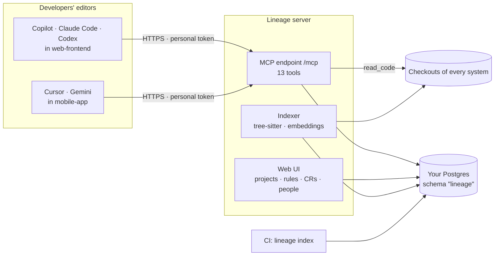

<div align="center">

# Lineage

**Your AI coding agent only sees one repository. Your features span five.**

Lineage is an MCP server that gives GitHub Copilot, Claude Code, Codex, Cursor and any MCP agent
the code of *every* system your team owns, the rules and vocabulary you agreed on, and the history
of every change request, so agents build against the right API instead of guessing.

[](https://github.com/tanwarAalok/lineage/actions/workflows/ci.yml)


[](LICENSE)

[What it does](#what-lineage-does) · [How the MCP server works](#how-the-mcp-server-works) · [Developers: get started](#developers-get-started) · [Teams: onboarding](#teams-onboarding-step-by-step) · [Tools](#mcp-tools-reference)

</div>

---

## What Lineage does

Real features cross repositories. A checkout change touches the web app, an order service, a
payment service and shared config, each owned by a different team. AI agents fail at exactly that:

- **They only see the open repo.** Ask about the backend API from the frontend and the agent guesses
  the request shape, or answers *"cannot be determined from this repository"*.
- **Team knowledge isn't readable.** Which contract was agreed, what "order total" means, which
  rules apply: it lives in meetings, wikis and people's heads.
- **Big and legacy codebases defeat search.** 10,000+ files, COBOL batches, PL/SQL, odd encodings.

Lineage runs as one server for the whole team and gives every agent:

| | |
| --- | --- |
| 🔎 **Every system's code** | Semantic + keyword search across all indexed repos, and `read_code` for files the developer doesn't have checked out. |
| 📖 **Rules and dictionary** | The team's rules and what design terms mean, each with its source. Agents only see approved entries. |
| 🔗 **Change-request memory** | For each CR: the API, event and config contracts systems agreed (versioned), decisions, and which code implements it, found automatically from commit messages. A CR built on another inherits all of that, with warnings when the foundation changed. |
| 🧭 **A system map** | What each project is ("orders-service: backend for orders and pricing"), so "the backend" means something. |
| 🔒 **Your data, your infrastructure** | Everything lives in your own Postgres. No Lineage cloud, no telemetry, no LLM calls. |

### A real example

A developer has only the **web frontend** open and asks their agent:

> *I need to call the backend's create-order API. What endpoint is it, what request body does it
> expect, and what does it return?*

The agent asks Lineage (verbatim from the audit log):

```text
search_code("create order endpoint request body")              → hits in orders-service
read_code("…/OrderController.java",          project="orders-service")
read_code("…/model/CreateOrderRequest.java", project="orders-service")
read_code("…/OrderResponse.java",            project="orders-service")
```

and answers with the exact contract, cited to the backend's code:

> **`POST /api/orders`**: `customerId` (string, required), `lines[]` (`sku`, `quantity ≥ 1`,
> `unitPrice`; at least one), `discountCode` (optional). Returns `{ orderId, status, total }`.
> ⚠️ Project rule: the web app goes through the API gateway, never calls orders-service directly.

Nothing in that answer exists in the frontend repository.

---

## How the MCP server works



### What happens when a developer works on a change request

The requirements come from where your team already keeps them: the developer hands the agent the
CR's design document, or the agent reads the ticket and pages itself through a **Jira or
Confluence MCP server** configured alongside Lineage. Lineage doesn't replace those; it adds what
the documents can't know: what the CR builds on, what other systems already agreed and built, and
the actual code in every repository.

```mermaid
sequenceDiagram
    participant Dev as Developer
    participant Agent as AI agent (in web-frontend)
    participant Docs as Jira / Confluence MCP (optional)
    participant L as Lineage MCP server
    Dev->>Agent: "Implement CR-3002" + design document<br/>(or: "requirements are in SHOP-3002")
    opt requirements live in Jira / Confluence
        Agent->>Docs: fetch ticket SHOP-3002 and its linked HLD page
        Docs-->>Agent: requirements; "builds on CR-3001"
    end
    Agent->>L: get_project_context()
    L-->>Agent: rules, dictionary, what this repo is, the other systems
    Agent->>L: get_cr("CR-3002")
    alt CR-3002 already known to Lineage
        L-->>Agent: CR + what it builds on (CR-3001): agreed contracts,<br/>decisions, code in each system, warnings for THIS repo first
    else first time Lineage hears of it
        L-->>Agent: only code/commit mentions + "record it with propose_cr"
        Agent->>L: propose_cr("CR-3002", summary from the doc,<br/>depends_on=["CR-3001"], source="SHOP-3002")
        Agent->>L: get_cr("CR-3002")
        L-->>Agent: everything CR-3001 already agreed and built
    end
    Agent->>L: search_code / read_code across systems
    L-->>Agent: the relevant files and their source lines
    Agent->>Dev: code that follows the document AND matches what<br/>other systems agreed; open questions flagged
```

The document says **what** to build; Lineage supplies **what already exists around it**. When a
CR is new, the agent records it from its document (`propose_cr`, with the ticket or page as
source) so the next developer, and the next CR built on top of it, inherits that knowledge. A
maintainer confirms the proposal.

1. **Connect.** The agent's MCP client connects to `/mcp` with the developer's token. A missing or
   wrong token gets `401` immediately, so a misconfigured client fails loudly instead of looking
   connected. The token is re-checked on every call; roles are read fresh each time.
2. **Know where it is.** Each repo names its project once (an `X-Lineage-Project` header or
   `?project=` on the URL). `get_project_context` returns that project's rules and dictionary,
   what it is, and every other system, with the instruction that their code is reachable only
   through Lineage.
3. **Find code anywhere.** `search_code` searches **all** systems by default. It ranks files two
   ways and fuses them: by their best-matching code chunk (keyword + semantic), and by a
   plain-language description of each file. Business wording rarely matches code; it does match a
   file described in words.
4. **Read it.** `read_code` returns numbered lines from any indexed file on the server, even one in
   a repository the developer doesn't have. Only indexed files, never outside the project root,
   secrets redacted, 300 lines per call.
5. **Bring the team's memory.** Given a CR id (from the task, the design document or the Jira
   ticket), `get_cr` returns the change request plus everything it builds on, transitively: agreed contracts, decisions, the code each system wrote for it, and warnings, for
   example *"CR-3001's contract changed after CR-3002 started"* or *"your code predates the current
   contract: read it before relying on the contract"*.
6. **Propose, never decide.** Agents can only *suggest* new CRs, dictionary entries, contracts and decisions.
   Maintainers approve them in the web UI. Every call lands in the audit log with who made it.

### How Lineage learns your code

- **Parsing:** tree-sitter for 30+ languages (Python, Java, TypeScript, Go, C#, Kotlin, COBOL, VB6,
  PL/SQL, Pascal, Fortran and more) into symbols, call edges and searchable chunks. Legacy
  encodings and 3,000-line routines are handled.
- **Embeddings:** a small local model (`all-MiniLM-L6-v2`, CPU, ~90 MB, downloaded once). No code
  ever leaves the server.
- **Change requests:** CR ids (`CR-1234`, or your Jira keys) in commit messages and comments link
  each CR to the files and symbols that implement it, with no manual bookkeeping.
- **Incremental:** only files whose content changed are re-processed; an interrupted run resumes.
- **Secrets:** `.env`, keys and credential files are never indexed; tokens in code are redacted.

---

## Developers: get started

### If your team already runs Lineage (2 minutes)

1. **Get a token** from your Lineage admin. It is shown once; keep it private.
2. **Connect your AI tool.** If your repo already contains the Lineage config (most do), you only
   enter the token. Otherwise copy the setup from the web UI: *project → Connect*.

   | Tool | What to do |
   | --- | --- |
   | **GitHub Copilot** (VS Code) | Open the repo, open `.vscode/mcp.json`, click **Start** above `lineage`, paste your token when asked. Use Copilot Chat in **Agent** mode. |
   | **Claude Code** | Run in the repo: `claude mcp add --transport http --scope local lineage "https://<lineage-server>/mcp?project=<project>" --header "Authorization: Bearer <token>"` |
   | **Codex** | Set `LINEAGE_TOKEN` in your environment; the repo's `.codex/config.toml` does the rest. |
   | **Cursor** | Set `LINEAGE_TOKEN`; the repo's `.cursor/mcp.json` does the rest. |
   | **Gemini CLI** | Set `LINEAGE_TOKEN`; the repo's `.gemini/settings.json` does the rest. |
   | **Anything else** | Streamable HTTP to `https://<lineage-server>/mcp?project=<project>` with `Authorization: Bearer <token>`. |

3. **Check it works.** Ask your agent: *"What are this project's rules?"* It should call
   `get_project_context`. Then ask about code in another system, e.g. *"What request does the
   backend's create-order API expect?"*
4. **Optional:** sign in to the web UI with the same token to browse projects, the dictionary and
   change requests, and to suggest entries.

You are a **developer on every project** automatically. You never need database credentials or a
local index.

**Working on a change request:** give the agent the CR id and its requirements: attach or paste the
design document, or, if your agent also has a Jira or Confluence MCP server, point it at the ticket
("Implement CR-3002; requirements are in SHOP-3002"). The agent reads the requirements there and
gets everything around them from Lineage. Put CR ids in commit messages (`CR-3002: add delivery
date`) so Lineage links your code to the CR automatically.

### Try it alone on your machine (5 minutes)

No server, no accounts: a local SQLite index and Lineage running inside your editor.

```sh
git clone https://github.com/tanwarAalok/lineage.git && cd lineage
python -m venv .venv && .venv/Scripts/activate          # macOS/Linux: source .venv/bin/activate
pip install torch --index-url https://download.pytorch.org/whl/cpu   # Linux: skip the 2 GB GPU build
pip install -e .

export LINEAGE_ALLOWED_ROOTS=~/src                      # Windows: set LINEAGE_ALLOWED_ROOTS=C:\src
lineage index ~/src/orders-service --project orders-service   # first run downloads the ~90 MB model
lineage index ~/src/web-frontend   --project web-frontend
lineage search "create order API request body"
```

Then add `.vscode/mcp.json` to a repo:

```json
{
  "servers": {
    "lineage": {
      "type": "stdio",
      "command": "/path/to/lineage/.venv/bin/lineage",
      "args": ["serve"],
      "env": { "LINEAGE_ALLOWED_ROOTS": "/home/you/src" }
    }
  }
}
```

Open Copilot Chat in **Agent** mode and ask about code in the repo you *don't* have open.

---

## Teams: onboarding step by step

One person, the **admin**, sets Lineage up once. Everyone else just connects their tool.

| Step | Who | What | How |
| --- | --- | --- | --- |
| 1 | DBA | Create a database for Lineage | `CREATE EXTENSION vector;` `CREATE ROLE lineage_app LOGIN PASSWORD '…';` `CREATE SCHEMA lineage AUTHORIZATION lineage_app;` |
| 2 | Admin | Install and start the server | `pip install -e ".[pg]"`, set `LINEAGE_DB_URL` and `LINEAGE_ALLOWED_ROOTS`, run `lineage db check`, then `lineage serve --transport streamable-http --host 0.0.0.0 --tls-cert … --tls-key …` (or the Docker image) |
| 3 | Admin | Create the admin account | `lineage user add <you> --admin`, then sign in to the web UI with the printed token |
| 4 | Admin | Onboard every system | Web UI → **Projects → Onboard a project** (a checkout on the server). Indexing runs in the background with live progress. |
| 5 | Admin | Describe each system | Project page → one-line description, e.g. *"order-service: backend for orders; calls payment-service"* |
| 6 | Admin / maintainers | Write rules and the dictionary | Project → **Rules** and **Dictionary**, each entry with its source (HLD section, meeting, person) |
| 7 | Admin / leads | Register change requests (optional up front) | **Change requests → Register**: id, summary, what it builds on, link to the ticket or design doc. Providers record agreed contracts; decisions get logged. CRs not registered here are proposed by agents from their documents when work starts. |
| 8 | Admin | Add people | **People → Add a person** → send each their token. Everyone is a developer on every project; choose **maintainers** per project to approve suggestions. |
| 9 | One developer per repo | Connect the repo | Project → **Connect** → pick the team's AI tool → commit the generated config and instruction file (`copilot-instructions.md`, `CLAUDE.md`, `AGENTS.md` or `GEMINI.md`) |
| 10 | CI | Keep the index fresh | On merge to main: `lineage index <checkout> --project <project>`. Only changed files are re-processed. |

After step 9, each new developer needs only step 1–3 of [Developers: get started](#if-your-team-already-runs-lineage-2-minutes).

Full details (managed Postgres providers, TLS, Docker, running several servers, upgrades):
[docs/deployment.md](docs/deployment.md).

### Roles

| Role | Who | Can |
| --- | --- | --- |
| **admin** | created with `lineage user add <name> --admin` | everything: onboard projects, rules, dictionary, CRs, people, maintainers |
| **maintainer** | optional, chosen per project by an admin | approve suggestions and contracts for that project, edit rules, re-index |
| **developer** | everyone else, automatically, on every project | use every project from their editor; suggest terms, rules, contracts and decisions |

---

## MCP tools reference

| Tool | What the agent gets |
| --- | --- |
| **Context** | |
| `get_project_context(project?)` | This repo's approved rules and dictionary, what the system is, and the map of other systems. Agents call it first. |
| `list_projects()` | Every system, your role, the latest indexing job. |
| **Code** | |
| `search_code(query, top_n?, project?)` | The most relevant files across **all** systems, each with its project, a one-line meaning, matching symbols and line range. `project` narrows. |
| `read_code(path, project, start_line?, end_line?)` | Numbered lines from any system's indexed file, including repos not in the workspace. |
| `resolve_term(term, project?)` | What a business or design term means and which code implements it. |
| **Change requests** | |
| `get_cr(cr)` | A CR with everything it builds on: agreed contracts, decisions, implementing code per system, and warnings (this repo's own first). |
| `get_contract(cr?, provider?, name?, history?)` | Agreed REST, event and config contracts, including those inherited from parent CRs; `history` returns every version. |
| `list_crs(status?)` | Registered CRs and what each depends on. |
| **Contributions** (proposals for maintainers) | |
| `propose_cr(cr, title, summary, depends_on?, references?, source?)` | A CR Lineage doesn't know yet, recorded from its design document or Jira/Confluence ticket, with the CRs it builds on. |
| `suggest_term(term, definition, source?, symbol?, path?)` | A dictionary entry, optionally linked to the code implementing it. |
| `propose_contract(cr, provider, name, spec, consumers?, source?)` | A contract the developer says was agreed. |
| `log_decision(cr, question, decision, system?, source?)` | A design or implementation decision. |
| **Admin** | |
| `onboard_project(repo_path, project?)` | Admins: index a new system (background job). Maintainers: re-index theirs. |

---

## Quality and performance

**Search** on [Saleor](https://github.com/saleor/saleor) (4,644 files) with 24 vague,
business-language requirements and the correct files pinned beforehand (12 never influenced any
tuning): the right file is in the top 10 for **88%** of requirements and in the top 3 for 54%.
Given a three-requirement CR with Saleor reachable only through Lineage, Copilot named every
correct file using `search_code` and `read_code` alone.

**Scale**, on a generated 22,000-file repo (8-core laptop, Postgres + pgvector): first index 90 s
(storage and parsing; embedding with the default model adds time on CPU, about 14 minutes for
Saleor's 4,644 files), re-index with nothing changed 7 s, search 60–100 ms.

**Agents tested:** GitHub Copilot CLI and Claude Code end to end on single-repo, cross-repo and
multi-CR scenarios, verified against the audit log; Copilot in VS Code connects and calls the tools.

---

## Security in short

Random tokens stored only as hashes · authorization enforced on the server for every call ·
secrets never indexed and redacted in output · TLS required for remote databases and non-local
serving · every call audited. Details: [docs/security.md](docs/security.md).

## Roadmap

- [x] Cross-system search and `read_code`; rules and dictionary with provenance
- [x] Web UI, roles, tokens, background jobs, audit log
- [x] Hosted Postgres: TLS, migrations, multiple servers, least-privilege role
- [x] Legacy languages and encodings; 20k+ file repos
- [x] Change requests: versioned contracts, decision log, CR dependencies, drift warnings
- [x] Two-level semantic search tuned on a real codebase
- [ ] Invite links and optional SSO (OIDC)
- [ ] `check_impact`: callers, callees and downstream systems affected by a change
- [ ] Schema-level drift detection (today: commit dates against contract changes)
- [ ] Jira / Azure Boards import of CRs; HLD and Confluence ingestion

## Development

```sh
pip install -e ".[dev]"     # includes an embedded Postgres for the test suite
pytest                      # every test runs against both SQLite and Postgres + pgvector
```

```
src/lineage/
  server.py · web.py · cli.py   MCP tools, web UI and API, command line
  service.py · auth.py          use cases, roles and authorization, shared by every entry point
  crs.py                        change-request context: inheritance, contracts, drift warnings
  indexer.py · ingest/          parallel incremental indexing, tree-sitter parsing, embedders
  search.py · assets.py         two-level retrieval; generated agent instructions
  store/                        one Store interface: sql.py (shared) · sqlite.py · postgres.py
  security.py                   secret detection, redaction, path guards
```

Configuration: [`config/lineage.example.yaml`](config/lineage.example.yaml) · Deployment:
[docs/deployment.md](docs/deployment.md) · Security: [docs/security.md](docs/security.md)

## License

[MIT](LICENSE)
