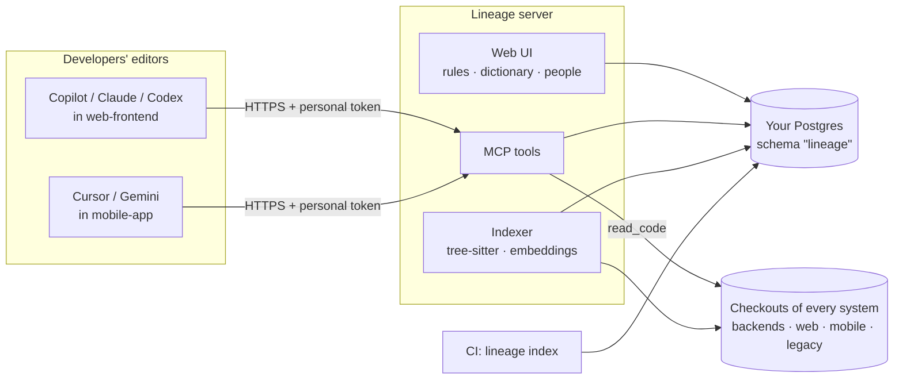

<div align="center">

# Lineage

**Your AI coding agent only sees one repository. Your features span five.**

Lineage gives Copilot, Claude, Codex, Cursor and any MCP agent a map of *every* system you own
(backends, frontends, mobile, legacy) plus the project rules and vocabulary your team agreed on.

[](https://github.com/tanwarAalok/lineage/actions/workflows/ci.yml)


[Quickstart](#quickstart) · [How it works](#how-it-works) · [Tools](#mcp-tools) · [Deploy for a team](docs/deployment.md) · [Security](docs/security.md) · [Roadmap](#roadmap)

</div>

---

## The problem

On a large enterprise codebase, agents fall over in predictable ways:

- **Keyword search times out** on 10,000+ files, and the agent burns tokens rediscovering structure.
- **The answer lives in another repo.** You're building a frontend screen; the API it must call is
  defined in a backend service you don't have open. The agent guesses the request shape, or says
  *"cannot be determined from this repository"*.
- **Integration knowledge lives in meetings.** Which API, which contract, what "order total"
  actually means: none of it is anywhere an agent can read.
- **Legacy code** (COBOL batches, PL/SQL packages, Windows-1252 files, 3,000-line routines) is
  invisible to most tools.

## See it work

A developer has only the **web frontend** repo open and asks their agent:

> *I need to call the backend's create-order API from this frontend. What endpoint and HTTP
> method is it, what request body does it expect, and what does it return?*

The backend lives in another repository. The agent asks Lineage (a real run, from the audit log):

```text
search_code("create order endpoint request body")              → hits in orders-service
read_code("…/OrderController.java",       project="orders-service")
read_code("…/model/CreateOrderRequest.java", project="orders-service")
search_code("OrderResponse from order",   project="orders-service")
read_code("…/OrderResponse.java",         project="orders-service")
```

and answers with the exact contract, cited to the backend's source (condensed):

> **`POST /api/orders`** — `orders-service/…/OrderController.java:20`
>
> | Field | Type | Required |
> | --- | --- | --- |
> | `customerId` | string | yes |
> | `lines[]` | `{ sku: string, quantity: int ≥ 1, unitPrice: decimal }` | yes, at least one |
> | `discountCode` | string | no |
>
> Returns `{ orderId, status: "PENDING" | "AUTHORISED" | "FAILED", total }`, where `total`
> includes tax applied after discounts. — `orders-service/…/OrderResponse.java:13`
>
> ⚠️ Project rule: *the web app only calls the API gateway, never orders-service directly.*

None of that is in the frontend repository: the field names, the validation rules and the team's
rule all came through Lineage. Every call is audited, so you can prove where an answer came from.

## Features

|  |  |
| --- | --- |
| 🔎 **Cross-system search** | Hybrid keyword + vector search over every indexed system, ranked per file with a one-line meaning. Agents read code in repos they don't have open. |
| 📖 **Project rules & dictionary** | Admins write the rules agents must follow and what design terms mean, with the **source** of each claim. Agents only ever see approved entries. |
| 🧭 **System map** | Each project says what it is ("orders-service: backend for orders, pricing and payments"), so "the backend" means something to an agent. |
| 🏛️ **Built for legacy** | Tree-sitter for 30+ languages incl. COBOL, VB6, PL/SQL, Pascal, Fortran; old encodings; giant routines split so they stay searchable. |
| 📈 **Scales** | 22,000 files indexed in ~90 s; incremental re-index in seconds; resumable after a crash. |
| 🔒 **Your data stays yours** | Everything lives in *your* Postgres. No Lineage cloud, no telemetry, no LLM calls: code never leaves your network. |
| 👥 **Team-ready** | Tokens, roles (admin / maintainer / developer), a web UI, background jobs, audit log, multi-server safe. |
| 🔌 **Plain MCP** | Works with GitHub Copilot agent mode, Claude Code and any MCP client. Nothing to install in the editor. |

## How it works



1. **An admin onboards each system** (repo checkout on the server). Lineage parses it with
   tree-sitter into symbols, call edges and chunks, and embeds them locally.
2. **The admin sets rules and a dictionary** in the web UI, each with its source (an HLD
   section, a meeting, a person).
3. **Each repo commits a `.vscode/mcp.json`** from the web UI's *Connect* page. It names the
   project; every developer enters their own token.
4. **Agents call Lineage tools** for context, search and code from any system, and *suggest*
   new terms, which maintainers approve.

## Quickstart

Five minutes, one machine, SQLite (for a POC; teams use [hosted Postgres](docs/deployment.md)).

```sh
git clone https://github.com/tanwarAalok/lineage.git && cd lineage
python -m venv .venv && .venv/Scripts/activate          # macOS/Linux: source .venv/bin/activate
pip install -e .

export LINEAGE_ALLOWED_ROOTS=~/src                      # Windows: set LINEAGE_ALLOWED_ROOTS=C:\src
lineage index ~/src/orders-service --project orders-service
lineage index ~/src/web-frontend   --project web-frontend
lineage search "create order API request body"
```

Hook it into VS Code by adding `.vscode/mcp.json` to a repo:

```json
{
  "servers": {
    "lineage": {
      "type": "stdio",
      "command": "/path/to/lineage/.venv/bin/lineage",
      "args": ["serve"],
      "env": { "LINEAGE_ALLOWED_ROOTS": "/home/you/src" }
    }
  }
}
```

Open Copilot Chat in **Agent** mode and ask about code in a repo you *don't* have open.

> **Want the web UI and multiple users?** Run `lineage user add <you> --admin`, then
> `lineage serve --transport streamable-http` and open http://127.0.0.1:8000. The full team setup
> is in [docs/deployment.md](docs/deployment.md).

## Works with your AI tool

Lineage is a standard MCP server over streamable HTTP. Each developer uses their own token; it
never goes into a committed file. The web UI's **Connect** page generates all of these for a project.

| Tool | Setup | Reads instructions from |
| --- | --- | --- |
| **GitHub Copilot** (VS Code) | `.vscode/mcp.json` with `"type": "http"`, prompts for the token | `.github/copilot-instructions.md` |
| **Claude Code** | `claude mcp add --transport http --scope local lineage "https://lineage.example/mcp?project=web-frontend" --header "Authorization: Bearer <token>"` | `CLAUDE.md` |
| **Codex** | `.codex/config.toml`: `url`, `bearer_token_env_var = "LINEAGE_TOKEN"`, `http_headers = { "X-Lineage-Project" = "web-frontend" }` | `AGENTS.md` |
| **Cursor** | `.cursor/mcp.json`: `url` + `"Authorization": "Bearer ${env:LINEAGE_TOKEN}"` | `AGENTS.md` |
| **Gemini CLI** | `.gemini/settings.json`: `httpUrl` + `"Authorization": "Bearer $LINEAGE_TOKEN"` | `GEMINI.md` |
| **Anything else** | URL + `Authorization: Bearer` header; stdio-only clients via `npx mcp-remote` | `AGENTS.md` |

The project comes from the `X-Lineage-Project` header or `?project=` on the URL. A wrong or
missing token is refused with `401` at connect time, so a misconfigured client fails loudly
instead of looking connected.

## MCP tools

| Tool | What the agent gets |
| --- | --- |
| `get_project_context()` | This repo's approved rules and dictionary, what the system is, and the map of other systems. Called first. |
| `search_code(query, project?)` | The few relevant files across **all** systems, each with its project and a one-line meaning. `project` narrows. |
| `read_code(path, project)` | Numbered source lines from any system, even one not in the workspace. Secrets redacted, audited. |
| `resolve_term(term)` | What a business/design term means and which code implements it, across systems. |
| `suggest_term(term, definition, source?)` | A proposal for maintainers to review: agents never write approved knowledge. |
| `list_projects()` | Every system, your role and the latest indexing job. |
| `onboard_project(repo_path)` | Admins: index a new system (background job). Maintainers: re-index. |

## Who does what

| Role | Who | Can |
| --- | --- | --- |
| **admin** | created with `lineage user add <name> --admin` | onboard projects, set rules and dictionary, add people, choose maintainers |
| **maintainer** | optional, per project | approve suggestions, edit rules, re-index |
| **developer** | everyone else, automatically, on every project | use any project; suggest terms, rules and code links |

## Performance

A generated 22,000-file repo (Java, Python, JS, COBOL, PL/SQL, VB; 41 MB) on an 8-core laptop:

| | SQLite (POC) | Postgres 16 + pgvector |
| --- | --- | --- |
| First index | 76 s | 90 s |
| Re-index, nothing changed | 1.9 s | 7.1 s |
| Search (median) | 216 ms | 60 ms |
| Search over a 31 ms cross-region link | n/a | 133 ms |

Indexing is parallel, incremental by content hash, and resumable. Numbers use the built-in
`hash` embedder; a semantic model (`st:` or `ollama:`) improves ranking at some indexing cost.

## Roadmap

- [x] Hybrid cross-system search, `read_code`, project rules and dictionary with provenance
- [x] Web UI, roles, tokens, background jobs, audit log
- [x] Hosted Postgres: TLS, migrations, multi-server, least-privilege role
- [x] Legacy languages and encodings; 20k+ file repos
- [ ] **Contract registry keyed by change request (CR)**: agreed vs. implemented API contracts, with drift detection
- [ ] `check_impact`: callers, callees and downstream systems affected by a change
- [ ] **Decision log** with provenance: HLD → decision → LLD → generated code
- [ ] CR dependency graph: build on top of the CRs a change depends on
- [ ] HLD / Confluence ingestion (lands as `proposed`, never trusted automatically)

## Documentation

- [Deploying for a team](docs/deployment.md): hosted Postgres, the DBA's one-time SQL, Docker, configuration
- [Security model](docs/security.md): tokens, roles, secrets, transport, audit
- [`config/lineage.example.yaml`](config/lineage.example.yaml): every setting

## Development

```sh
pip install -e ".[dev]"     # includes an embedded Postgres for the test suite
pytest                      # every test runs against both SQLite and Postgres + pgvector
```

```
src/lineage/
  server.py · web.py · cli.py   MCP tools, web UI/API, command line
  service.py · auth.py          use cases, roles and authorization (one place for all entry points)
  indexer.py · ingest/          parallel incremental indexing; tree-sitter parsing; embedders
  search.py · assets.py         hybrid retrieval; generated agent instructions
  store/                        one Store interface: sql.py (shared) · sqlite.py · postgres.py
  security.py                   secret detection, redaction, path guards
```

Known limits, each with an upgrade path: calls resolve by bare name (same-named methods share
callers); summaries come from docstrings and signatures, not an LLM; COBOL paragraphs and Kotlin
methods are not yet separate symbols.
